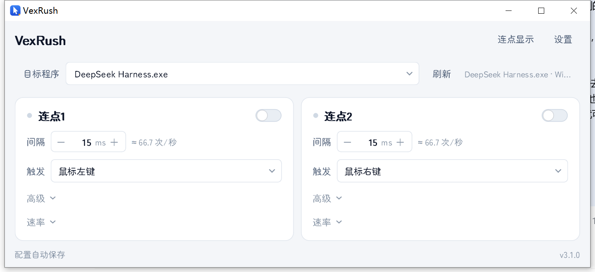
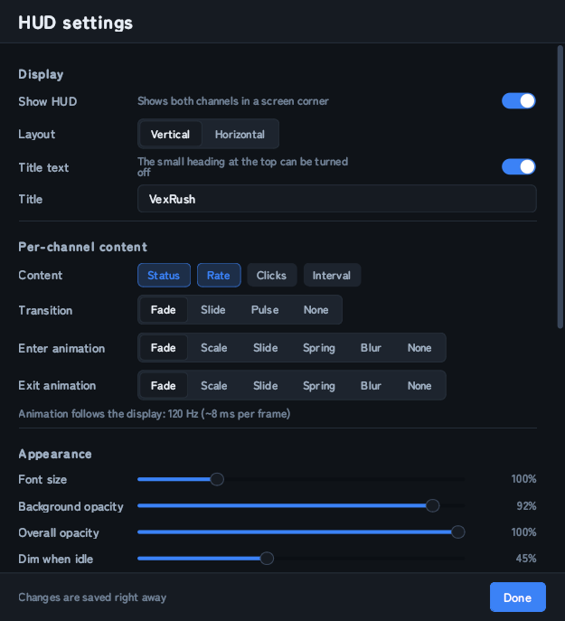

# VexRush

**Dual-channel autoclicker for Windows** ｜ [简体中文](README.md)

A dual-channel autoclicker for Windows: the left and right buttons each get an independent
channel, both usable at the same time without running two programs. Clicks are delivered to the
target window as window messages, so the cursor is not moved and the target does not need to be
in the foreground.



## Features

- Two independent channels, each with its own interval, trigger, simulated button and hotkey.
- Clicks are sent as `PostMessage` / `SendMessage`; the cursor is never captured and the target
  window may stay in the background.
- Automatic target detection, preferring a foreground `java.exe` / `javaw.exe`; other programs
  can be picked from a list or entered by process name.
- Four themes, six accent colours plus a custom picker, four UI font sizes, and a selectable UI
  font (ChillRoundM is bundled).
- Simplified Chinese and English UI. Language files are JSON and can be added freely.
- Overlay (HUD) showing state, rate, click count and interval for both channels, vertical or
  horizontal, with enter/exit animations and click-through support.
- Settings are saved automatically in `%APPDATA%\VexRush\config.json`, including window
  position and both channel switches.
- Built-in update check: GitHub direct connection with automatic proxy fallback, line speed test
  before download and SHA-256 verification afterwards.

## Window

The main window consists of a target selection bar and two channel cards.

| Control | Description |
| --- | --- |
| Switch (top right) | Enables the channel; also toggled by its hotkey |
| Interval | Delay between clicks, 1–2000 ms. 15 ms is about 66 clicks/s, 10 ms about 100 clicks/s |
| Trigger | Mouse left / right / middle, or any keyboard key (select "Custom key" and press it) |
| Advanced (collapsible) | Channel name, simulated button, on/off hotkey. The name is also used in the overlay |
| Rate (collapsible) | Live rate curve, total clicks, current clicks per second |

The top bar also contains the **Click HUD** toggle and the **Settings** entry.

## Usage

1. Start `VexRush.exe`.
2. Select the target program under "Target app"; for Minecraft this is normally `javaw.exe`.
3. Set the interval, enable the channel, then hold the trigger. Clicks start on press and stop
   on release.

## Settings

| Section | Contents |
| --- | --- |
| Appearance | Theme, accent colour (including a custom picker), UI font size, UI font, UI language |
| Target app | Auto-detection, message delivery mode (`PostMessage` background / `SendMessage` synchronous) |
| Exclusive mode | **Only one channel**: enabling one channel disables the other. **Restore previous**: disabling the current channel re-enables the one it replaced (only the most recent one is remembered) |
| IME | Unavailable (greyed out); see Known limitations |
| HUD | Opens the overlay settings window |
| Config file | Real config path, open data folder, import, export, reset to defaults |

Window easing can be disabled separately: dragging the title bar eases the window towards the
cursor and snaps on release.

## Overlay

A frameless always-on-top panel for recording or streaming.



- Layout: vertical or horizontal. The heading above the rows can be hidden and reworded.
- Content: state, rate, clicks, interval — each individually switchable.
- Enter / exit animations: fade, scale, slide, spring, blur, none. Frame interval follows the
  monitor refresh rate, capped at 144 Hz.
- Dragging: eased interpolation while held (can be disabled or tuned). On release the panel
  snaps to the pointer; only a fast flick adds a small amount of inertia, limited to 16 px, and
  the panel cannot leave the screen.
- Appearance: font size, background opacity (backdrop only), overall opacity (including text),
  idle dimming, corner radius, padding, row gap, background and text colours, accent source
  (follow theme / per channel / custom), rainbow flow and its speed.
- Context menu: lock position, click-through, per-field toggles, replay animation, open
  settings, hide overlay.

## Language packs

UI languages are JSON files in `%APPDATA%\VexRush\lang\`, shipped with `zh_cn.json`,
`en_us.json` and the template `example.json`.

```json
{
  "_name": "Deutsch",
  "interval": "Intervall",
  "click": "Klick %d"
}
```

- Keys are stable semantic IDs; copy `example.json` and translate the values.
- `_name` is the name shown in the language list.
- Keep the `%d`, `%s` and `%0.1f` placeholders; `%%` is a literal percent sign.
- Missing keys fall back to the built-in Simplified Chinese text, then to the key itself.
- Languages added by users are marked *unofficial* in the list.

## Updates

Updates are published as GitHub Releases of this repository and can be checked, downloaded and
installed from inside the application.

- *Check update* on the right side of the settings title bar runs a manual check; the result is
  shown right after the button (with a spinner while checking).
- A silent check runs once after startup. When a newer build exists, a hint appears in the footer
  of the main window and opens the update window; it can be turned off in
  *Settings → Usage → Check on startup*.
- The release API is queried over the direct GitHub connection first and falls back within two
  seconds to `cdn.gh-proxy.org`, `v6.gh-proxy.org` and `gh-proxy.org`.
- Available lines are speed-tested and sorted before downloading, and the download is verified
  against the SHA-256 published by the GitHub API; a mismatching file is discarded and the next
  line is tried.
- Release notes are rendered as Markdown in the update window. Installing closes the
  application, replaces `VexRush.exe` and restarts it. Downloads are kept in
  `%APPDATA%\VexRush\update\`.

## Requirements

- Windows 10 / 11 (x64).
- Single portable executable, no installation. Settings live in `%APPDATA%\VexRush`; deleting
  that folder restores the defaults.

## Known limitations

- Programs that read input through `DirectInput` / `Raw Input` do not accept window messages and
  cannot be clicked this way.
- If the target runs elevated, VexRush must run elevated as well, otherwise the system blocks
  the window messages.
- The "ignore while typing" option is temporarily unavailable: input-box and IME composition
  detection differs too much between programs to be reliable, so the option is off and locked.
- Hotkeys are captured by a low-level keyboard hook. `F1`–`F24` are additionally registered with
  the system hotkey API so they still trigger when the hook is unavailable; letters and digits
  use the hook only and therefore never intercept normal typing.
- While the VexRush window is in the foreground no clicks are sent, so interacting with its own
  interface never leaks into the target.

## Development

### Running from source

```bat
pip install PyQt5 pywin32 pynput psutil pyinstaller
python main.py                 :: run from source
python main.py --multi         :: ignore the single-instance lock
```

High DPI uses `AA_EnableHighDpiScaling` and `AA_UseHighDpiPixmaps` with the `PassThrough`
rounding policy.

### Building

```bat
python -m PyInstaller --noconfirm --clean dual_clicker.spec
:: output: dist\VexRush.exe (onefile, console-less, icon + version info, embeds assets\fonts and assets\lang)
```

Close any leftover `dist\VexRush.exe` process first, otherwise the build fails with
`PermissionError: [WinError 5]`.

### Tests

```bat
python tests\selftest.py     :: config read/write and migration, theme and language, HUD geometry and dragging, window message delivery
python tests\e2e_test.py     :: real keyboard and mouse input, target window counters, hotkey toggling, foreground guard
python tests\exe_check.py    :: packaged binary: high DPI size, config round-trip, position restore on restart
```

All three suites run real windows and real input on Windows, and point `APPDATA` at a temporary
directory so the user configuration is neither read nor written.

- Drag and animation tests need a clean temporary `APPDATA`; a leftover window geometry makes
  them fail for the wrong reason.
- `e2e_test` sets `cfg.exclusive = False` to verify the channels are independent; exclusive mode
  is covered separately in `selftest`.
- `exe_check` deletes `dist\config.json`: a leftover portable config is migrated into the data
  directory at startup and brings the old window size with it.

### Layout

```
main.py                  entry point: high DPI, single instance, QApplication, fonts, language
app/
  config.py              config dataclasses, atomic save, v1→v2 migration, data and lang dirs
  engine.py              input listening, target registry, click worker, channels
  winapi.py              screen and refresh-rate queries, window-message clicks, hotkey registration
  theme.py               design tokens, QSS and palette generation, custom accents
  widgets.py             custom controls (switch, number field, segmented control, sparkline)
  mainwindow.py          main window: target bar, channel cards, footer, signal wiring
  channel_card.py        one channel card (interval / trigger / advanced / rate)
  window_drag.py         caption drag takeover, hotkey registration, sizing helpers
  switcher.py            blurred curtain used while switching themes
  overlay.py             overlay painting, layout, dragging and position
  overlay_anim.py        overlay enter/exit animations and easing curves
  overlay_menu.py        overlay context menu
  overlay_settings.py    overlay settings window
  settings.py            application settings window
  dialogbase.py          shared dialog scaffolding (header, scroll area, footer, grid rows)
  fonts.py               bundled font loading and system font enumeration
  i18n.py                language packs: built-in assets/lang plus user lang\
  icon.py                application icon drawing
  screen.py              monitor geometry helpers (clamping points and widgets on-screen)
  textfmt.py             number and text formatters
  debug.py               optional file logging (VEXRUSH_DEBUG)
  updater.py             release check, mirror speed test, SHA-256 verification, download
  update_dialog.py       update window and the check / download worker threads
assets/fonts/            ChillRoundM and its OFL licence text
assets/lang/             zh_cn.json, en_us.json, example.json
tests/, tools/           test suites and developer tools (preview.py, make_icon.py)
docs/                    screenshots referenced by the READMEs
```

### Implementation notes

- Click scheduling uses `time.perf_counter()`. `time.monotonic()` maps to `GetTickCount64` on
  Windows with 15.6 ms granularity, which collapses intervals of 15 ms or less to about 16 ms.
- The `WM_MOVING` / `WM_SIZING` `lParam` rectangle is in physical pixels while Qt `geometry()`
  is in logical pixels; they must not be mixed under DPI scaling. Window dragging is handled by
  the application instead of the system modal move loop.
- PyQt5 terminates the process when a slot raises an uncaught exception, so timer and input
  callbacks are wrapped in `try/except`.
- `QFontDatabase` and `QFontMetrics` require an existing `QApplication`, otherwise the frozen
  build exits with `0xC0000005` at startup without any stderr output.
- Splitting modules can drop module-level constants; the resulting `NameError` only appears when
  that code path executes.

## Licence

The application source is MIT — see `LICENSE`.

The bundled font **ChillRoundM** comes from [Warren2060/ChillRound](https://github.com/Warren2060/ChillRound)
and is licensed under the SIL Open Font License 1.1; the licence text ships next to the font at
`assets/fonts/LICENSE-ChillRound.txt`. Its reserved font names (`ChillRoundF`, `ChillRoundM`)
are kept unchanged as the OFL requires, and the font is not covered by the MIT licence above.
