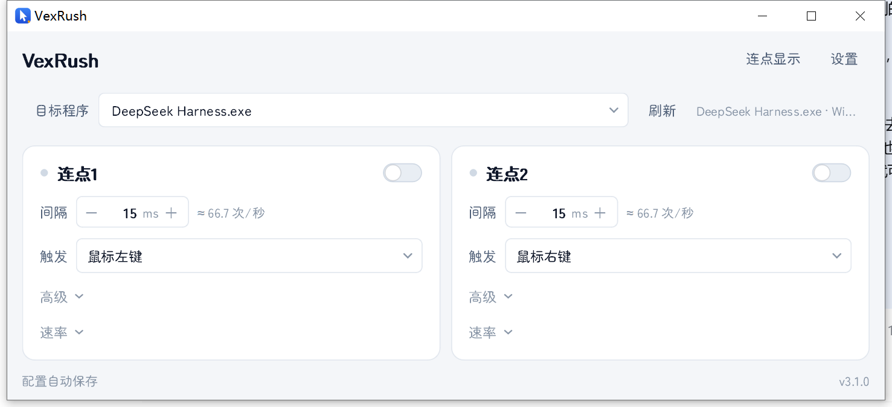
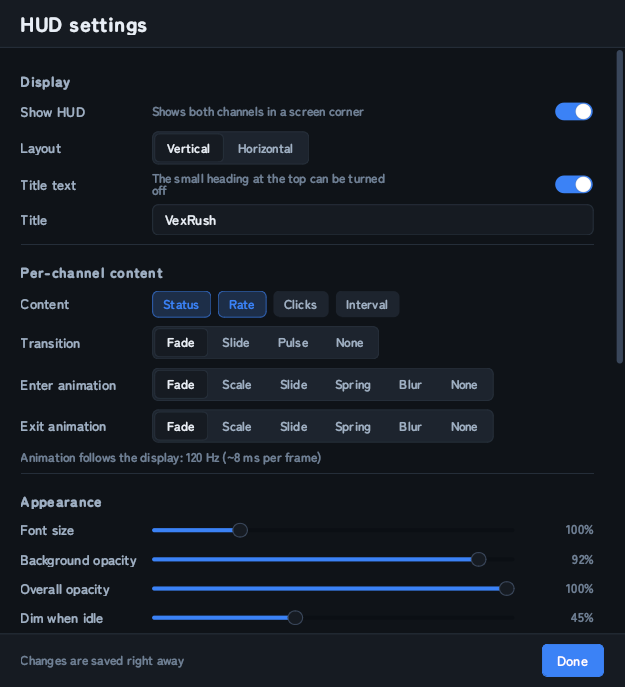

# VexRush

**Windows 双通道连点器** ｜ [English](README.en.md)

Windows 平台的双通道连点器：左键、右键各占一路独立通道，两路可同时开启，无需运行两个程序。
点击以窗口消息形式投递给目标窗口，光标不移动，目标窗口也不需要在最前面。



## 功能

- 两路独立通道，分别设置间隔、触发键、模拟点击键与开关热键，互不影响。
- 点击以 `PostMessage` / `SendMessage` 投递，不抢占光标，目标窗口可在后台。
- 目标程序自动识别，优先选择拥有前台窗口的 `java.exe` / `javaw.exe`，其余程序可手动选择或输入进程名。
- 4 套主题、6 种强调色与自定义取色、4 档界面字号，界面字体可换（内置寒蝉半圆体 ChillRoundM）。
- 简体中文 / English 界面，语言文件为 JSON，可自行新增。
- 悬浮显示（HUD）：两路状态、速率、次数、间隔，纵向或横向排布，支持入场/出场动画与点击穿透。
- 配置自动保存，位于 `%APPDATA%\VexRush\config.json`，含窗口位置与两路开关状态。
- 内置更新检查：GitHub 直连与加速站自动切换，安装包下载前测速、下载后校验 SHA-256。

## 界面

主窗口由目标程序选择栏与两张通道卡片组成。

| 控件 | 说明 |
| --- | --- |
| 右上开关 | 该路的启用状态，也可由开关热键切换 |
| 间隔 | 两次点击的间隔，1–2000 ms。15 ms 约 66 次/秒，10 ms 约 100 次/秒 |
| 触发 | 鼠标左键 / 右键 / 中键，或任意键盘键（选「自定义键盘键」后按下） |
| 高级（可展开） | 通道名称、模拟点击按键、开关热键。名称同时作用于悬浮显示 |
| 速率（可展开） | 实时速率曲线、已连点次数、当前每秒次数 |

顶部另有「连点显示」开关与「设置」入口。

## 使用

1. 运行 `VexRush.exe`。
2. 在「目标程序」中选择要连点的程序，Minecraft 一般会自动选到 `javaw.exe`。
3. 设置间隔，打开对应通道的开关，按住触发键即开始连点，松开立即停止。

## 设置

| 分区 | 内容 |
| --- | --- |
| 外观 | 主题、强调色（含自定义取色）、界面字号、界面字体、界面语言 |
| 目标程序 | 自动识别、消息发送方式（`PostMessage` 后台消息 / `SendMessage` 同步消息） |
| 防卡手 | **只允许开一路**：开启一路时关闭另一路；**关闭后恢复**：关闭当前路时重新开启被挤掉的那路（仅记录最近一路） |
| 输入法 | 暂不可用（灰显），详见「已知限制」 |
| 悬浮显示 | 打开悬浮显示设置窗口 |
| 配置文件 | 配置文件真实路径、打开数据目录、导入、导出、恢复默认 |

窗口缓动可单独关闭：拖动标题栏时窗口缓动跟随鼠标，松手吸附。

## 悬浮显示

置顶的无边框面板，用于录制或直播时显示两路状态。



- 排布：纵向 / 横向；顶部标题文字可关闭并自定义。
- 显示内容：状态、速率、次数、间隔，逐项开关。
- 入场 / 出场动画：淡入、缩放、滑入、弹簧、柔焦、无。帧间隔跟随显示器刷新率，上限 144 Hz。
- 拖动：按住时插值跟随（可关闭或调整强度），松手先吸附到指针位置，仅快速甩动时带少量惯性，最大位移 16 px，不会移出屏幕。
- 外观：字号、背景不透明度（仅背景）、整体不透明度（含文字）、未开启淡化、圆角、内边距、行间距、底色与文字色、强调色来源（跟随主题 / 按通道 / 自定义）、彩虹流光及速度。
- 右键菜单：锁定位置、点击穿透、逐项显示开关、试播动画、打开设置、关闭悬浮显示。

## 语言包

界面语言由 `%APPDATA%\VexRush\lang\` 下的 JSON 文件提供，内置 `zh_cn.json`、`en_us.json` 与模板 `example.json`。

```json
{
  "_name": "Deutsch",
  "interval": "Intervall",
  "click": "Klick %d"
}
```

- 键名为稳定的语义 ID，复制 `example.json` 后翻译值即可。
- `_name` 为语言列表中显示的名称。
- 保留 `%d`、`%s`、`%0.1f` 等占位符，`%%` 表示百分号本身。
- 缺少的键依次回退到内置简体中文、再回退到键名本身。
- 用户自行添加的语言在列表中标注为「非官方」。

## 更新

更新源为仓库的 GitHub Releases，可在程序内检查、下载并安装。

- 「设置」标题栏右侧的「检查更新」手动检查，结果直接显示在按钮后面（检查时按钮后为转圈）。
- 启动时在后台静默检查一次，发现新版本时主界面底部出现提示，点击进入更新窗口；可在「设置 → 使用 → 启动时检查更新」关闭。
- 查询接口优先直连 GitHub，2 秒内无响应时依次改用 `cdn.gh-proxy.org`、`v6.gh-proxy.org`、`gh-proxy.org`。
- 下载前对每条可用线路测速并按实测速度排序，下载过程中校验 SHA-256（取自 GitHub 接口），不一致则丢弃并换线路重试。
- 更新内容以 Markdown 渲染在更新窗口中；安装时关闭程序、替换 `VexRush.exe` 后自动重启。下载的安装包位于 `%APPDATA%\VexRush\update\`。

## 系统要求

- Windows 10 / 11（x64）。
- 单文件便携版，无需安装。配置保存在 `%APPDATA%\VexRush`，删除该目录即恢复默认。

## 已知限制

- 通过 `DirectInput` / `Raw Input` 读取输入的程序不接收窗口消息，此类程序无法用本方式连点。
- 目标程序以管理员权限运行时，本程序也需以管理员权限运行，否则系统会拦截窗口消息。
- 「打字时不响应」暂时下线：各程序对输入框与输入法组合的判断差异过大，无法可靠区分，该选项默认关闭并锁定。
- 热键由低级键盘钩子接收；`F1`–`F24` 额外注册为系统热键，钩子失效时仍可触发。字母与数字键只走钩子、不注册系统热键，因此不会截获正常输入。
- 本窗口处于前台时不向外发送点击，以免点击自身界面时误触目标窗口。

## 开发

### 环境与运行

```bat
pip install PyQt5 pywin32 pynput psutil pyinstaller
python main.py                 :: 从源码运行
python main.py --multi         :: 忽略单实例限制
```

高 DPI 使用 `AA_EnableHighDpiScaling` 与 `AA_UseHighDpiPixmaps`，缩放策略为 `PassThrough`。

### 打包

```bat
python -m PyInstaller --noconfirm --clean dual_clicker.spec
:: 产物：dist\VexRush.exe（单文件、无控制台、含图标与版本信息，内嵌 assets\fonts 与 assets\lang）
```

打包前需关闭遗留的 `dist\VexRush.exe` 进程，否则会因文件占用报 `PermissionError: [WinError 5]`。

### 测试

```bat
python tests\selftest.py     :: 配置读写与迁移、主题与语言、HUD 几何与拖动、窗口消息投递
python tests\e2e_test.py     :: 真实按键与鼠标、目标窗口计数、热键切换、前台保护
python tests\exe_check.py    :: 打包产物：高 DPI 尺寸、配置往返、重启位置还原
```

三套测试均在 Windows 上运行真实窗口与真实输入，运行时将 `APPDATA` 指向临时目录，不读取也不写入用户配置。

- 拖动与动画测试需要干净的临时 `APPDATA`，否则遗留的窗口几何会导致失败。
- `e2e_test` 使用 `cfg.exclusive = False`，验证两路互不影响；防卡手在 `selftest` 中单独覆盖。
- `exe_check` 会删除 `dist\config.json`：遗留的便携配置会在启动时迁移进数据目录并带入旧窗口尺寸。

### 目录结构

```
main.py                  入口：高 DPI、单实例、QApplication、字体与语言初始化
app/
  config.py              配置数据类、原子写入、v1→v2 迁移、数据目录与语言目录
  engine.py              输入监听、目标窗口注册、连点线程、通道
  winapi.py              屏幕与刷新率查询、窗口消息点击、热键注册
  theme.py               设计令牌、QSS 与调色板生成、自定义强调色
  widgets.py             自绘控件（开关、数值输入、分段选择、速率曲线等）
  mainwindow.py          主窗口：目标选择栏、通道卡片、页脚与信号连接
  channel_card.py        单路通道卡片（间隔 / 触发 / 高级 / 速率）
  window_drag.py         窗口拖动接管、热键注册、尺寸自适应
  switcher.py            切换主题时的模糊幕布
  overlay.py             悬浮显示：绘制、布局、拖动与位置
  overlay_anim.py        悬浮显示入场 / 出场动画与缓动曲线
  overlay_menu.py        悬浮显示右键菜单
  overlay_settings.py    悬浮显示设置窗口
  settings.py            设置窗口
  dialogbase.py          设置窗口公共骨架（标题、滚动区、页脚、网格行）
  fonts.py               内置字体加载与系统字体列表
  i18n.py                语言包：内置 assets/lang 与用户 lang\
  icon.py                程序图标绘制
  screen.py              显示器区域计算（点与窗口的屏幕内夹取）
  textfmt.py             数值与文本格式化
  debug.py               可选文件日志（环境变量 VEXRUSH_DEBUG）
  updater.py             更新检查、加速站测速、SHA-256 校验、下载与安装脚本
  update_dialog.py       更新窗口、检查与下载线程
assets/fonts/            寒蝉半圆体 ChillRoundM 与 OFL 许可证
assets/lang/             zh_cn.json、en_us.json、example.json
tests/, tools/           测试与开发工具（preview.py、make_icon.py）
docs/                    README 引用的截图
```

### 开发注意事项

- 连点排程使用 `time.perf_counter()`。`time.monotonic()` 在 Windows 上是 `GetTickCount64`，粒度 15.6 ms，会把 15 ms 及更短的间隔压成约 16 ms。
- `WM_MOVING` / `WM_SIZING` 的 `lParam` 矩形为物理像素，Qt 的 `geometry()` 为逻辑像素，高缩放下不可混用。窗口拖动由程序自行接管，不使用系统模态移动循环。
- PyQt5 在槽函数抛出未捕获异常时会终止进程。定时器与输入回调需要包一层 `try/except`。
- `QFontDatabase`、`QFontMetrics` 只能在 `QApplication` 创建之后使用，否则打包版会在启动时以 `0xC0000005` 退出且无 stderr 输出。
- 拆分模块时容易遗漏模块级常量，相关 `NameError` 只在实际执行到该代码路径时暴露。
- 更新检查与下载在工作线程中执行，界面线程只处理结果；下载使用临时 `.part` 文件，校验通过后才落盘。
- 测试与手动运行前应清理遗留的源码版实例：它们同样以 `python.exe` 存在、窗口标题也为 VexRush，会被被测程序选为目标窗口。

## 许可

程序源码采用 MIT 许可证，见 `LICENSE`。

内置字体 **ChillRoundM** 来自 [Warren2060/ChillRound](https://github.com/Warren2060/ChillRound)，采用 SIL Open Font License 1.1，许可证文本随字体置于 `assets/fonts/LICENSE-ChillRound.txt`。其保留字体名（`ChillRoundF`、`ChillRoundM`）按 OFL 要求保持未修改，且该字体不在上述 MIT 许可范围内。
